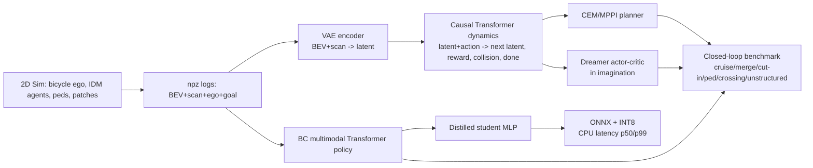

# driving-world-model

An action-conditioned generative world model for autonomous driving: learn from multi-sensor logs, plan and learn a policy inside the model (model-based RL), evaluate in closed-loop simulation, then distill to a small ONNX policy for edge deployment. It mirrors a Physical AI pipeline: perception logs → vehicle actuation.

## Problem
Open-loop prediction accuracy does not imply safe driving. This repo trains a latent world model on scripted-expert logs, uses it for planning (CEM/MPPI) and imagination-based RL (Dreamer-style actor-critic), and — critically — scores every policy **closed-loop** in held-out seeded scenarios, where compounding errors, collisions and comfort are visible.

## Architecture


## Quickstart
```bash
python3 -m venv .venv && . .venv/bin/activate
pip install -e '.[dev]'
python -m dwm.run --epochs 3 --episodes 24   # data -> train -> benchmark -> distill (CPU, minutes)
pytest -q && ruff check dwm tests
```
Artifacts: `artifacts/*.pt|*.onnx`, full tables in [`reports/report.md`](reports/report.md), machine-readable `reports/results.json`, rollout strip `reports/rollout_strip.png`.

## Results (actual small CPU run — regenerate with the command above)
<!-- RESULTS:START -->
Small run: `python -m dwm.run --epochs 3 --episodes 24 --steps 60` (29s, CPU). Full detail: `reports/report.md` / `reports/results.json`.

**World-model open-loop horizon errors**

| horizon | latent MSE | decoded BEV IoU |
|---|---|---|
| 1 | 0.315 | 0.00 |
| 5 | 0.271 | 0.00 |
| 15 | 0.200 | 0.00 |

IoU is 0 at this tiny scale (decoded raster rarely crosses the 0.5 threshold) — a concrete example of why open-loop metrics alone mislead; latent error is the diagnostic used here.

**Closed-loop benchmark (held-out seeds 100–101, 60-step episodes)**

| policy | route ↑ | collision ↓ | off-road ↓ | jerk ↓ | progress ↑ |
|---|---|---|---|---|---|
| expert (scripted) | 0.46 | 0.00 | 0.20 | 0.14 | 83.4 |
| BC Transformer | 0.40 | 0.00 | 1.00 | 0.11 | 71.4 |
| CEM/MPPI (world model) | 0.17 | 0.00 | 1.00 | 3.92 | 26.1 |
| Dreamer actor-critic | 0.03 | 0.00 | 1.00 | 0.25 | 4.5 |
| distilled student | 0.35 | 0.00 | 0.70 | 0.03 | 63.5 |

Untrained-at-scale planners underperform the expert/BC — expected for 3 epochs; closed-loop exposes this where open-loop would not. Student retains most of BC's route completion (0.35 vs 0.40) with lower jerk.

**Distillation / latency:** student ONNX exported (`artifacts/student.onnx`); INT8 + p50/p99 CPU latency via `dwm.distill.quantize_and_benchmark` requires `onnxruntime`, which has no wheel for the local Python 3.15 venv — it runs in CI (Python 3.11) and on any 3.11/3.12 venv (`pip install -e '.[dev]'`); locally the run records `latency.error` in `reports/results.json` instead of fabricating numbers.
<!-- RESULTS:END -->

## Components
| # | Module | What |
|---|---|---|
| 1 | `dwm/sim.py`, `dwm/data.py` | Seeded bicycle-model sim (IDM + lane changes, pedestrians, off-road patches); BEV raster + LiDAR-like scan + ego/goal; expert+noise logger → npz shards |
| 2 | `dwm/models.py` (`WorldModel`) | VAE (BEV+scan) + causal Transformer dynamics conditioned on (steer, accel); predicts next latent/reward/collision/done. Horizon errors (1/5/15) + trajectory querying in `dwm/evaluate.py` |
| 3 | `dwm/planning.py` | CEM/MPPI over the world model; Dreamer-style actor-critic in imagination; steer-rate/jerk constraints (`apply_constraints`) |
| 4 | `dwm/models.py` (`BCPolicy`) | Behavior-cloning multimodal Transformer (BEV + scan + goal tokens → actions) |
| 5 | `dwm/evaluate.py` | Closed-loop benchmark: route completion, collision, off-road, comfort (jerk), progress + per-scenario failure breakdown |
| 6 | `dwm/distill.py` | Distill → student MLP → ONNX → INT8 (onnxruntime) → CPU p50/p99 latency; closed-loop score drop reported |

## Design tradeoffs
- **Model-based vs model-free:** the world model enables planning and cheap imagined RL/reuse across policies, but suffers compounding latent error (see horizon table) and model bias; BC/model-free is simpler and stable yet cannot query counterfactual actions. We keep both and let closed-loop scores arbitrate.
- **Why closed-loop beats open-loop metrics:** latent MSE/IoU can improve while the policy still crashes (distribution shift, compounding error). Closed-loop rollouts expose collisions, off-road and jerk that open-loop scores hide — hence the benchmark is the headline metric, horizon error is diagnostic.
- **Latency budgets:** edge actuation needs ~10–50 ms budgets; the planner (sampling + Transformer rollouts) is far too slow for the loop, so it is distilled to a tiny MLP exported to ONNX/INT8 and benchmarked for p50/p99 on CPU. Report quantifies the score drop paid for that latency.

## Limitations
2D synthetic sim and scripted-expert logs only — no real sensor noise, 3D geometry, or human data; tiny default models/runs for laptop CPU (use `--epochs/--episodes` to scale). Future work: CARLA or Isaac Sim adapter behind the same `DrivingSim` observation/action interface, VQ latents, larger Transformer dynamics, real-log ingestion.
